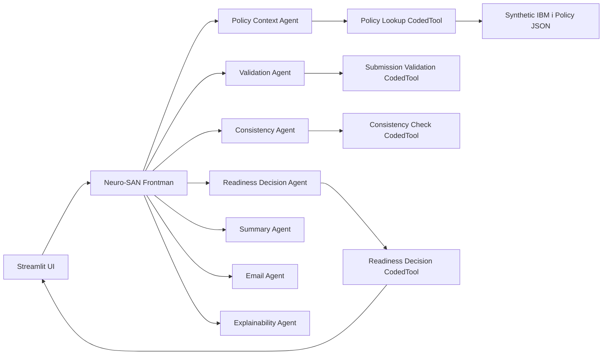

# Broker Submission Readiness Checker Architecture

The application combines deterministic Python business rules, an optional Neuro-SAN narrative network, a human-reviewed Streamlit interface, and a local synthetic policy lookup. It checks intake completeness only; it does not perform underwriting, pricing, risk selection, acceptance, or rejection.

## Layers and responsibilities

### Neuro layer: communication and narrative

The Neuro-SAN frontman coordinates policy context, validation, consistency, readiness, summary, email, and explanation agents. Summary, communication, and explanation text may be model-assisted. This narrative is supplemental and cannot override the deterministic report. The Email Agent only drafts text; no send capability is configured.

### Symbolic/deterministic layer: validation and readiness

`validation.py` checks required fields and documents. `consistency.py` compares submitted values to policy values and applies configured materiality thresholds. `readiness.py` applies the status rule:

- Missing required fields, missing required documents, or invalid values => `NEEDS INFORMATION`.
- No such gaps => `READY FOR UNDERWRITER REVIEW`.

The status represents submission completeness for routing, not an underwriting decision. Python computes it before optional LLM invocation.

### Human layer: review and approval

The underwriter or authorized operator reviews missing information, comparisons, rule explanations, and the email draft. The UI requires an explicit confirmation and approval action before presenting the copyable email content. The human remains responsible for review; no email is transmitted.

### Legacy integration layer: mock IBM i retrieval

`policy_repository.py` reads the synthetic `data/policies.json` file through the same small lookup interface intended for a future IBM i REST adapter. The current implementation has no network connection to IBM i and uses synthetic data only.

## Request flow

1. The operator selects or enters a policy number and structured submission values in Streamlit.
2. The application retrieves a validated synthetic policy object.
3. Deterministic Python identifies missing fields/documents, invalid values, field differences, and configured material changes.
4. Python calculates the sole readiness status and emits a stable report.
5. Streamlit renders that report and a broker email draft, gated by human review before offering copy.
6. Optionally, the operator invokes the Neuro-SAN direct session for supplemental narrative. The UI retains the original Python status as authoritative.
